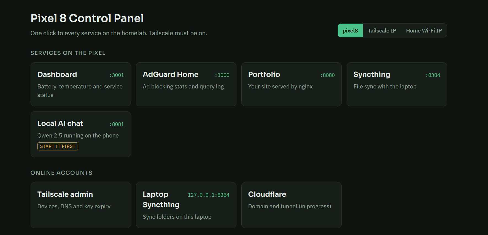
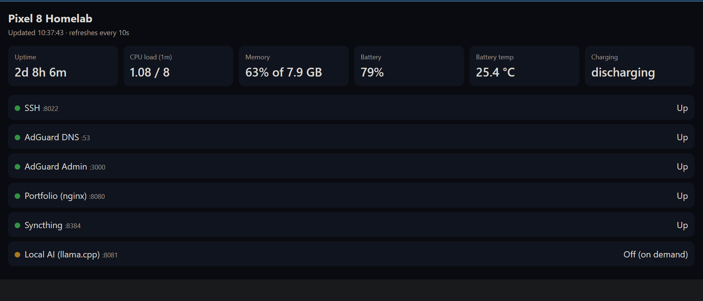
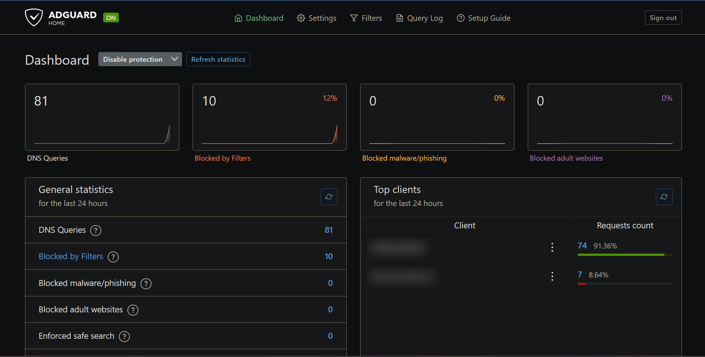
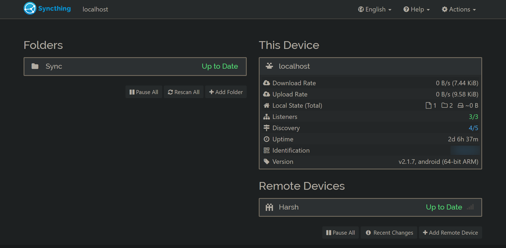
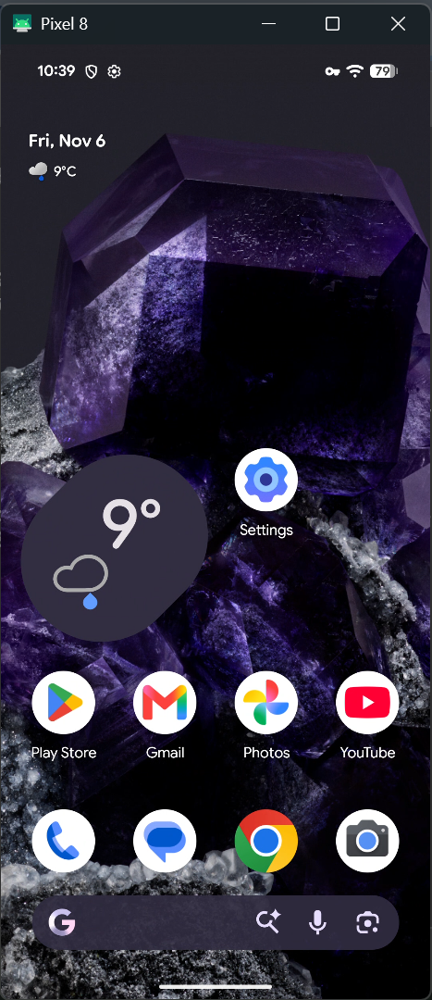

# Phone-Kill

### Turning my old Pixel 8 into a home server

I upgraded phones and had a spare Pixel 8 sitting around. Instead of selling it, I turned it into a small always-on home server.

It sits at home on Wi-Fi, plugged in 24/7, and I manage it from my laptop or iPhone from anywhere.



## What it does

- **Ad blocking** with AdGuard Home, only for my own devices (through Tailscale DNS, not the whole home network)
- **File backup** with Syncthing, a laptop folder syncs to the phone automatically
- **Hosts my portfolio site** with nginx
- **Health dashboard** showing uptime, CPU, memory, battery, temperature and service status
- **Local AI chat** with Qwen 2.5 on llama.cpp, started only when I need it
- **Control panel** with one click links to every service
- **Remote access** over Tailscale + SSH, plus full screen control with scrcpy

## Stack

| Part | What I used |
|---|---|
| Device | Pixel 8 (128 GB), rooted |
| Linux environment | Termux |
| Remote access | Tailscale (WireGuard), OpenSSH |
| DNS / ad blocking | AdGuard Home, upstream DNS over HTTPS (Cloudflare, Quad9) |
| Web | nginx |
| Sync | Syncthing |
| Local AI | llama.cpp running Qwen 2.5 |
| Screen control | scrcpy over wireless ADB |
| Auto start | Termux:Boot |

## How it works

```
iPhone / Laptop
      |
  Tailscale (encrypted WireGuard tunnel, no open ports)
      |
  Pixel 8 (Termux)
   ├── SSH         :8022
   ├── AdGuard     :3000 (UI), :53 (DNS)
   ├── Dashboard   :3001
   ├── Portfolio   :8080
   ├── Local AI    :8081 (on demand)
   └── Syncthing   :8384
```

- No ports are opened on the router. Every device makes an outbound connection to Tailscale, so the home firewall stays closed.
- Only DNS goes through the phone. Normal browsing goes straight to the internet.
- SSH uses key login only.

## Screenshots

**Health dashboard**, refreshes every 10 seconds. This one had been up for over 2 days.



**AdGuard Home** blocking ads for my devices over Tailscale.



**Syncthing** keeping a folder in sync between my laptop and the phone.



**scrcpy** controlling the phone from my laptop over Tailscale, with the phone's screen turned off.



## Keeping it alive

Android likes to kill background apps, so I had to work around that:

- Root, so services can bind the ports they need and stay running
- Battery charging capped at 80% so it can stay plugged in all day
- Phantom process killer turned off and a Termux wake lock held
- Tailscale set to always-on VPN, key expiry disabled for the phone
- Termux:Boot runs a start script that brings back sshd, AdGuard, nginx and the dashboard after a reboot

## Problems I ran into

- Android kept killing Termux processes until I disabled the phantom process killer
- Wireless ADB resets after a reboot, so I re-enable port 5555 with root
- Running an AI model on a phone is heavy, so I made it on demand instead of always on
- My old domain expired, so I moved to a free subdomain

## What's next

- Public access to the portfolio through a Cloudflare tunnel (in progress)
- More services on the dashboard

---

Built by Harsh Rana, CIS student at KPU.
